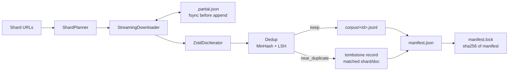

# Large Corpus Downloader

A streaming, resumable, deduplicating corpus downloader. It fetches compressed
JSONL shards over HTTP(S) or `file://`, resumes a dropped transfer from a
SHA-256-verified byte offset, decompresses Zstandard frames without materialising
a whole shard, drops near-duplicates with MinHash + LSH, and writes a manifest
whose content hash is recorded in `manifest.lock`.

The module is Python 3.11+ with one runtime dependency, `zstandard==0.25.0`.
The demo and tests never contact an external host.

## Quickstart

Prerequisites: [`uv`](https://docs.astral.sh/uv/) and Python 3.11+.

```bash
cd 42-large-corpus-downloader
uv sync --frozen --all-groups
uv run --frozen python code/main.py
```

The demo builds a synthetic corpus under `outputs/demo/remote`, compresses three
shards with Zstandard, downloads two through `file://` and one through a
loopback HTTP origin that deliberately disconnects halfway, resumes that shard,
deduplicates all nine documents, and verifies the manifest:

```text
demo corpus: outputs/demo
shard           docs  unique  dup  compressed  decompressed   output
shard-0000         3       2    1         221           503      332
shard-0001         3       2    1         303           512      308
shard-0002         3       2    1         298           491      301
total              9       6    3         822          1506      941
resume: shard-0001 resumed at 151 of 303 compressed bytes after a simulated disconnect
manifest: outputs/demo/manifest.json
manifest sha256: <printed per run; paths are part of the manifest>
```

Run the full gate (dependency sync, tests, strict mypy, demo, manifest verify):

```bash
./verify.sh
```

`outputs/`, `.venv/`, and caches are git-ignored, so the quickstart is safe to
rerun from a fresh clone.

## Architecture



| Component | Responsibility |
|---|---|
| `ShardPlanner` | Validates `http`/`https`/`file` URLs, derives safe shard ids, rejects duplicate ids and unknown expectations, maps cache/partial/checkpoint/output paths, and carries optional expected size and SHA-256. |
| `StreamingDownloader` | Opens a `urllib` request, optionally with `Range` and `If-Range`; validates status, `Content-Range`, and `Content-Length`; writes bounded chunks; checkpoints before appending; verifies the on-disk prefix before resuming; retries once from byte zero if the representation changed. |
| `ZstdDocIterator` | Wraps the compressed file object in `ZstdDecompressor.stream_reader(..., read_across_frames=True)`, reads bounded chunks, parses one JSON object per line, requires a string `text`, and assigns a stable document id when `id` is absent. |
| `MinHasher` | Tokenises on word characters, builds word n-gram shingles (default width 5), and produces a deterministic 128-component MinHash signature from a fixed family of splitmix64-mixed seeds. |
| `LSHIndex` | Splits each signature into 32 bands of 4 rows and keeps inverted buckets keyed by `(band index, row tuple)`. |
| `Dedup` | Exact raw-line SHA-256 fast path, LSH candidate lookup, exact MinHash Jaccard estimate against candidates, `keep` or `near_duplicate` verdict with the keeper's shard and document id. Only keepers are indexed. |
| `ManifestWriter` | Emits per-shard counts, compressed/decompressed/output sizes, per-shard SHA-256, a tombstone record per duplicate, and aggregate totals; writes `manifest.lock`. |
| `verify_manifest` | Re-checks the lock hash, schema, relative paths (no directory escape), file sizes and SHA-256, contiguous output offsets, tombstone targets, and declared totals. |

### Resume protocol

Each shard owns three files in the cache directory:

```text
<id>.jsonl.zst          final compressed shard
<id>.jsonl.zst.part     bytes received so far
<id>.jsonl.zst.partial.json
```

The checkpoint contains `shard_id`, `url`, `verified_bytes`, `expected_size`,
`sha256_prefix` over exactly `verified_bytes` bytes, validators (`etag`,
`last_modified`), and an attempt counter.

Invariants:

1. The checkpoint for the new offset is written atomically and `fsync`-ed
   **before** the corresponding bytes are appended. A crash can therefore make
   the checkpoint claim bytes that are not on disk; the next startup detects the
   short file, discards the state, and starts from zero. It cannot leave the
   shard with duplicate suffix bytes.
2. On startup the downloader recomputes `sha256_prefix` over the on-disk prefix.
   A mismatch (corrupt or externally modified partial) discards the checkpoint.
   The offset is never trusted, only verified.
3. Bytes on disk beyond the checkpoint are truncated before appending, so a
   crash between append and checkpoint rewrite is recoverable.
4. A resume request sends `Range: bytes=<verified>-` and `If-Range` with a strong
   ETag. A `206` must start exactly at the verified offset; a `200` means the
   server ignored the range and the download restarts from zero; a `416` whose
   `Content-Range` total equals the offset finalises the existing prefix.
5. A changed ETag/Last-Modified, or a changed total size, triggers exactly one
   fresh download. A second change is an error rather than an infinite loop.
6. Finalisation checks the expected size and SHA-256, truncates to the verified
   offset, renames the partial file into place, removes the checkpoint, and
   `fsync`s the directory.

`--resume-only` is a CI guard: every planned shard must have either a verified
final cache file or a checkpoint whose prefix hash matches. It refuses to start
a fresh download.

### Deduplication

Documents are shingled on case-folded word tokens. The default width is 5, so a
boilerplate footer changes only the shingles near the end and a tracking
parameter changes only the tail. A 128-component MinHash signature estimates
Jaccard similarity; LSH bands generate candidates; the candidate estimate is
then compared to the configured threshold (0.8) before a document is dropped.

The LSH banding is a **high-recall candidate generator**, not the threshold
enforcer. With `k=128, b=32, r=4`, the probability that two documents with true
Jaccard `s` collide in at least one band is

$$P(s) = 1 - (1 - s^r)^b.$$

At `s=0.8` that probability is effectively 1, and its 50% point is about 0.383,
so it also returns many below-threshold candidates. Those are rejected by the
exact 128-component estimate. This is deliberate: false candidates cost a
signature comparison, false negatives silently pollute the corpus. A sharper
0.8 curve would be `b=10, r=12` (50% point about 0.798), but that trades recall
at 0.8 for fewer bucket lookups. The spec's claim that `(b=32, r=4)` itself has
a 0.8 threshold is mathematically incorrect; the implementation keeps the
candidate check as the authority. The band/row layout is recorded in the
manifest for reproducibility.

Duplicate handling is tombstoned, not deleted: the manifest keeps the dropped
document's SHA-256, line number, verdict, matched shard id, matched document id,
and estimated Jaccard. The output shard contains only kept lines with explicit
byte offsets and lengths, so a downstream stage can address documents without
re-parsing or rescanning.

### Manifest contract

`manifest.json` contains:

- `schema_version`, `generator`;
- `dedup`: shingle unit and width, permutation/band/row counts, threshold, hash
  family;
- per shard: public URL (query and fragment removed), relative compressed and
  output paths, compressed/decompressed/output byte counts, compressed and
  output SHA-256, document/unique/duplicate counts, and one record per document;
- `totals`: shard, byte, document, unique, and duplicate counts.

`manifest.lock` is the standard `sha256  filename` form. `verify-manifest`
fails closed if the lock is missing, malformed, names another file, or differs
from the manifest bytes; it then revalidates every shard file and every
tombstone reference. A missing compressed cache file is tolerated because the
cache is evictable; the decompressed output shard is mandatory. The lock detects
accidental or partial edits, not a determined attacker who can rewrite both
files; it is not a signature.

## Real-provider mode

The same CLI accepts HTTPS shard URLs. Use pre-signed URLs; the manifest records
the URL without its query string, so credentials in query parameters are not
persisted. There is no custom-header or OAuth support in this lesson.

```bash
uv run --frozen python code/main.py fetch \
  --workdir outputs/run \
  --url https://data.example.org/corpus/shard-0001.jsonl.zst \
  --url https://data.example.org/corpus/shard-0002.jsonl.zst \
  --expected-size shard-0001=104857600 \
  --expected-size shard-0002=104857600 \
  --expected-sha256 shard-0001=<64 hex chars> \
  --expected-sha256 shard-0002=<64 hex chars> \
  --resume-only
```

Omit `--resume-only` to allow a fresh download. `--cache-dir`, `--corpus-dir`,
and `--manifest` relocate the three artifacts; all must remain inside the
manifest directory. `--shingle-width` changes the dedup shingle size.
`verify-manifest --manifest <path>` revalidates an existing run.

HTTPS uses `urllib` and the system trust store. The loopback demo explicitly
disables proxy environment variables for its `127.0.0.1` origin; real HTTPS
requests honour the environment's proxy configuration.

## What runs offline

- `python code/main.py demo`: builds synthetic JSONL, compresses it with
  Zstandard, uses `file://` URLs plus a loopback `ThreadingHTTPServer` bound to
  `127.0.0.1` on an ephemeral port. The server implements `Range`, `If-Range`,
  `206`, `416`, strong ETags, and one deterministic truncated response.
- `pytest`: no external network, no secrets, no fixed ports. The same loopback
  origin is used for resume and corruption tests.
- `mypy --strict`: static only.

No test downloads a third-party corpus. No paid API, GPU, or cloud sandbox is
involved.

## Measured results

Measured locally with Python 3.14.10, `zstandard` 0.25.0, on the checked-in
synthetic fixtures. These are observed values, not projected benchmarks.

`./verify.sh`:

```text
31 passed in 5.37s
Success: no issues found in 4 source files
verify: ok
```

Demo corpus (deterministic content):

| Shard | Docs | Unique | Dups | Compressed B | Decompressed B | Output B |
|---|---:|---:|---:|---:|---:|---:|
| shard-0000 | 3 | 2 | 1 | 221 | 503 | 332 |
| shard-0001 | 3 | 2 | 1 | 303 | 512 | 308 |
| shard-0002 | 3 | 2 | 1 | 298 | 491 | 301 |
| **total** | **9** | **6** | **3** | **822** | **1506** | **941** |

- Simulated disconnect: shard-0001 resumed at byte 151 of 303 after the first
  response was truncated. The second request carried `Range: bytes=151-` and
  `If-Range: "v1"`; the test suite asserts both.
- Shingle width changes the verdict on the footer near-duplicate: widths 3 and
  5 keep 6 of 9 documents (3 duplicates), width 9 keeps 7 of 9 (2 duplicates,
  one missed). MinHash estimates at the three widths are 0.852, 0.820, and
  0.766; width 5 is the default because it preserves the footer at 0.82 while
  remaining above the 0.8 threshold.
- LSH collision probabilities for the default `(b=32, r=4)`: `P(0.5)=0.873`,
  `P(0.8)≈1.000`, 50% point `0.383`. The exact signature check, not this curve,
  enforces the 0.8 verdict.
- Streaming is bounded by configuration, not shard size: the iterator test
  fails on `read(-1)` and asserts that every source read requests at most the
  configured `read_size` (7 bytes in that test). The downloader reads at most
  `chunk_size` per call (17 bytes in the resume tests).
- Re-running the same pipeline over the same inputs produces the same manifest
  SHA-256; the test asserts exact equality.

## Limitations and non-goals

- The LSH index is in memory and grows with unique documents. The production
  pattern of sharding it by band hash or moving it to SQLite/shelf is not
  implemented.
- Zstandard is the only codec; gzip sniffing by magic bytes is not implemented.
- There is no concurrent multi-writer lock on a work directory, no rate
  limiting, and no exponential-backoff retry loop. An interrupted transfer
  raises and expects the caller or CI to rerun; resume is safe across runs.
- `urllib` follows redirects and handles standard TLS and proxy settings. There
  are no custom auth headers, cookies, or cloud-provider SDKs.
- MinHash dedup is probabilistic: 128 components give an approximate Jaccard
  with sampling error, and LSH may miss a border-line pair. Hashes use a fixed
  family rather than a random per-run seed, which is required for reproducible
  manifests but means adversarial collisions are theoretically constructible.
- Word tokenisation is language-dependent and strips punctuation. Very short
  documents (fewer than 5 tokens) are one shingle and behave coarsely.
- Lines are capped at 16 MiB decompressed. Multipart byte ranges are not
  supported.
- The manifest lock is an integrity check, not an authenticity check.
- No GPU path exists; this stage is I/O and hashing only.

Skipped exercises: gzip sniffing, an on-disk LSH index, and multipart ranges.
Implemented exercises: `--shingle-width`, `--resume-only`, and the
`manifest.lock` startup check.

## Design decisions

- Standard library plus one pinned dependency. `zstandard` provides
  `stream_reader` with `read_across_frames=True`; the stdlib `compression.zstd`
  is newer than the supported Python floor.
- Checkpoint first, append second. This is the write-ahead ordering required to
  avoid duplicate suffix bytes after a power loss.
- Verify the prefix on every startup instead of trusting the offset.
- Keep tombstone records so a threshold change can be audited later.
- Store relative paths in the manifest so a run directory can be relocated, and
  strip query strings so signed credentials are not persisted.
- Fail closed on manifest/lock disagreement, path escape, size mismatch, hash
  mismatch, non-contiguous output, or a tombstone pointing at an unknown keeper.

## References

Sources actually used while implementing and reviewing this module:

1. [RFC 9110 — HTTP Semantics](https://www.rfc-editor.org/rfc/rfc9110.html):
   §13.1.5 `If-Range`, §14 Range Requests, §15.3.7 `206 Partial Content`, and
   §15.5.16 `416 Range Not Satisfiable`.
2. [RFC 8878 — Zstandard Compression](https://www.rfc-editor.org/rfc/rfc8878.html):
   frame/block format and the bounded-memory streaming property.
3. [python-zstandard — Decompression APIs](https://python-zstandard.readthedocs.io/en/stable/decompressor.html):
   `ZstdDecompressor.stream_reader(source, read_size, read_across_frames,
   closefd)` and the warning that single-shot decompression can allocate the
   whole output.
4. [datasketch — MinHash LSH](https://ekzhu.com/datasketch/lsh.html):
   the banding collision formula `P(s) = 1 - (1 - s^r)^b`, parameter tuning, and
   the reminder that LSH returns candidates that applications should verify.
5. [Python `urllib.request` documentation](https://docs.python.org/3/library/urllib.request.html):
   `Request`/`urlopen` behaviour, proxy handling, and the fact that read-time
   HTTP exceptions are not wrapped in `URLError`.

Spec: [Large Corpus Downloader](https://aiengineeringfromscratch.com/learn/capstone-projects/large-corpus-downloader).
