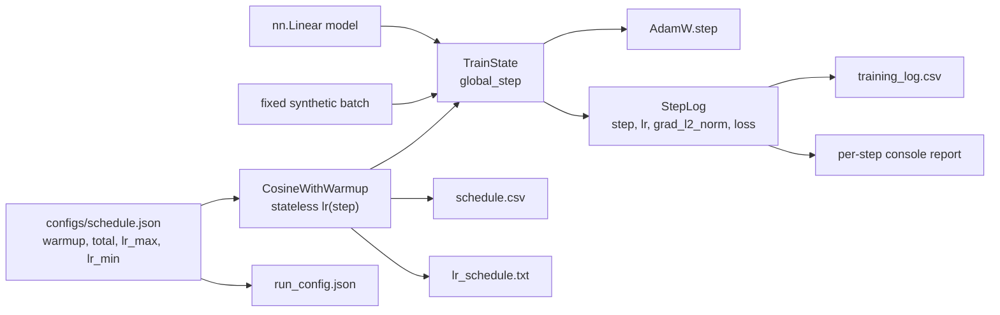

# Cosine LR with Linear Warmup

A real AdamW training step driven by a stateless cosine-with-linear-warmup
learning-rate schedule. The module computes the schedule's exact value at any
step, applies it to a tiny model, logs the gradient L2 norm beside the rate,
writes a fixed-schema CSV, and renders the curve as a text plot a reviewer can
read without a plotting dependency.

The implementation is self-contained: no sibling module imports, no provider
API, no GPU, no dataset download, and no network call in the tests. PyTorch
2.15.0+cpu is pinned; the demo runs on a deterministic 48-example synthetic
batch.

## Learning-rate contract

The schedule is one function over `step`, not three functions glued together.
For a validated config with `0 <= warmup_steps < total_steps`,
`lr_max > 0`, and `0 <= lr_min <= lr_max`:

| Region | Steps | Value |
| --- | --- | --- |
| Linear warmup | `warmup_steps > 0` and `0 <= step <= warmup_steps` | `lr_max * step / warmup_steps` |
| Cosine decay | `warmup_steps < step < total_steps` | `lr_min + 0.5 * (lr_max - lr_min) * (1 + cos(pi * progress))`, where `progress = (step - warmup_steps) / (total_steps - warmup_steps)` |
| Floor | `step >= total_steps` | `lr_min` |

Exact boundary behavior is part of the contract:

- `lr(0) == 0` when warmup is enabled.
- `lr(warmup_steps) == lr_max` exactly.
- `lr(total_steps) == lr_min` exactly.
- `lr(step) == lr_min` for every `step > total_steps`; the schedule does not
  extrapolate and does not raise.
- With `warmup_steps == 0`, step zero returns `lr_max` via the cosine branch and
  decay starts immediately at step 1.

The schedule owns no cursor and caches no table. Querying step 17, then 3, then
17 again returns the same values; this is what makes a resumed trainer safe as
long as it supplies the durable `global_step`.

## Architecture



| Component | Responsibility |
| --- | --- |
| `ScheduleConfig` | Validates and normalizes the four committed parameters; loads and snapshots JSON. |
| `CosineWithWarmup` | Stateless `lr(step)` with exact warmup, peak, total, and floor behavior. |
| `TrainState` | Holds model, AdamW, schedule, fixed batch, and monolithic `global_step`; runs one forward/backward/step and returns a `StepLog`. |
| `grad_l2_norm` | Norm of the concatenated gradient vector, computed after backward and before `optimizer.step()`. |
| `plot_schedule_ascii` | Samples the schedule into a fixed-width text grid, connects samples vertically, and labels peak/floor/warmup. |
| `write_schedule_csv` / `write_training_log` | Emit the fixed artifact schemas with round-trip float formatting. |
| `run_demo` / `main` | Builds the deterministic batch and model, trains, writes the run directory, and prints the report. |

The demo uses a three-class Gaussian cluster batch in four dimensions. A linear
classifier can fit it quickly, so the loss movement comes from the optimizer and
schedule rather than from a large model or a benchmark-scale corpus.

## Quickstart

Prerequisites: [`uv`](https://docs.astral.sh/uv/) and Python 3.11+.

```bash
cd 44-cosine-lr-warmup
uv sync --frozen --all-groups
uv run --frozen python code/main.py
```

The default run reads `configs/schedule.json`, trains for `total_steps = 20`
updates, prints one row per update, and writes:

```text
outputs/demo/training_log.csv
outputs/demo/schedule.csv
outputs/demo/lr_schedule.txt
outputs/demo/run_config.json
```

Run the full gate (dependency sync, tests, strict mypy, demo):

```bash
./verify.sh
```

`verify.sh` is idempotent: the demo creates its own directory and overwrites its
four artifacts. `outputs/`, `.venv/`, and caches are git-ignored.

Useful overrides:

```bash
uv run --frozen python code/main.py --steps 8 --seed 11 --workdir outputs/run-8
uv run --frozen python code/main.py --config configs/schedule.json --workdir outputs/run-config
```

`--steps` may exceed `total_steps`; the schedule pins at `lr_min` and the trainer
emits a `RuntimeWarning` for each step past the boundary instead of crashing.

## Configuration

`configs/schedule.json` is the committed source of truth:

```json
{
  "warmup_steps": 4,
  "total_steps": 20,
  "lr_max": 0.05,
  "lr_min": 0.005
}
```

Unknown keys, missing keys, boolean fields, non-finite values, and
`warmup_steps >= total_steps` are rejected with a contextual error. The loader
requires exactly the four keys so a typo cannot silently leave the schedule at a
default. A copy of the effective config is written to `run_config.json` in the
run directory.

The demo's 4-of-20 warmup is deliberately 20% of the run so the ramp is visible
in a short plot. Production language-model runs commonly use a much smaller
fraction (roughly 1–3%) and scale it with total duration; the schedule supports
any valid `0 <= warmup_steps < total_steps`.

## Artifacts and schema

`training_log.csv` is the durable per-step record. The column order is fixed:

```text
step,lr,grad_l2_norm,loss
0,0.0,0.8451894285809365,0.7648661136627197
1,0.0125,0.8451894285809365,0.7648661136627197
2,0.025,0.8263799707392764,0.741179883480072
```

`schedule.csv` has one `step,lr` row for every step from 0 through
`total_steps` inclusive. With the default config that is 21 rows: the ramp, the
peak, every decay step, and the exact floor endpoint.

`lr_schedule.txt` is the same text plot printed by the demo. It samples
`0..total_steps + max(1, total_steps // 10)`, so the default plot ends at step 22
and visibly shows the two-step floor tail after step 20.

`run_config.json` is a sorted snapshot of the four config values. The committed
config remains the source of truth; the snapshot makes each run directory
self-describing without requiring a separate manifest.

Gradient norm is the Euclidean norm of all parameter gradients concatenated into
one vector, not a sum of per-parameter norms. It is logged before
`optimizer.step()`, so it describes the gradient that produced the update. A
diverging run usually shows the norm rising before the loss does.

## What runs offline

Everything:

- The schedule, trainer, plot, and CSV writers are local Python.
- The demo model and batch are generated from fixed seeds; no corpus is read.
- Tests use tiny in-memory modules and `tmp_path`; they do not open sockets or
  call external services.
- Dependency installation is the only network step, and it uses the pinned CPU
  PyTorch index and `uv.lock`.

## Optional GPU and real-corpus integration

There is no paid provider in this lesson. The schedule is a plain function and
the trainer is device-agnostic Python; the measured path is CPU only.

- **GPU:** replace the pinned CPU wheel with a CUDA build of the same PyTorch
  version, then move the model, inputs, and targets to the device before
  constructing `TrainState`. `grad_l2_norm` uses `.item()` and works for device
  tensors, but no CUDA result is claimed here.
- **Real corpus:** a language-model trainer would replace the fixed classifier
  batch with token windows and a causal-LM loss. `TrainState` is intentionally
  generic about the model and loss shape; the schedule and logging do not depend
  on the synthetic batch. That integration is not implemented or measured in
  this module.

## Measured results

Measured locally on CPU with Python 3.14.10 and `torch 2.15.0+cpu`, using the
committed config and `DEMO_SEED = 7`:

| Measurement | Result |
| --- | --- |
| Default demo training updates | 20 |
| First logged loss | 0.764866 |
| Final logged loss | 0.201210 |
| Maximum logged gradient L2 norm | 0.845189 |
| Schedule CSV rows | 21 data rows (steps 0–20) |
| Training CSV rows | 20 data rows |
| Tests | 30 passed |
| Strict mypy | no issues in 6 source files |

The first two rows have the same loss and gradient norm because step 0 applies
`lr = 0`; AdamW therefore performs no parameter update at step 0, but still
records the gradient norm. This is the schedule contract, not a logging bug.

The demo is not an LLM benchmark. The numbers demonstrate that the schedule is
wired into a real optimizer, that the loss moves in the expected direction, and
that the artifacts are produced deterministically. Rerunning the same command
reproduces the four artifact files byte for byte.

## Limitations

- The toy model is a 15-parameter linear classifier, not a transformer or a
  language model.
- No gradient clipping, mixed precision, distributed training, or checkpoint
  I/O is implemented. A resumed trainer must pass its durable step as
  `global_step`; model and optimizer state persistence are left to the caller.
- The schedule is exercised in float32 on CPU. No numerical comparison against
  another framework or a CUDA run is claimed.
- No peak-learning-rate sweep is run. `lr_max = 0.05` is a legible demo choice,
  not a tuned recommendation.
- The text plot is intentionally dependency-free; the optional matplotlib PNG
  and LambdaLR wrapper from the source lesson's exercises are not included.
- The floor is nonzero by design (`lr_min = 10%` of `lr_max`), but the demo never
  trains past step 19, so the floor is demonstrated by the boundary line and the
  plot tail rather than by a long training run.

## References

1. Ilya Loshchilov and Frank Hutter, "SGDR: Stochastic Gradient Descent with
   Warm Restarts," arXiv:1608.03983.
   <https://arxiv.org/abs/1608.03983>
2. Ilya Loshchilov and Frank Hutter, "Decoupled Weight Decay Regularization,"
   arXiv:1711.05101.
   <https://arxiv.org/abs/1711.05101>
3. PyTorch 2.15 documentation, `torch.optim.AdamW`.
   <https://docs.pytorch.org/docs/2.15/generated/torch.optim.AdamW.html>
4. PyTorch 2.15 documentation, `torch.optim.lr_scheduler.LambdaLR`.
   <https://docs.pytorch.org/docs/2.15/generated/torch.optim.lr_scheduler.LambdaLR.html>
5. Google Machine Learning, "Deep Learning Tuning Playbook: Learning rate."
   <https://developers.google.com/machine-learning/guides/deep-learning-tuning-playbook/learning-rate>

## License

MIT. See [LICENSE](LICENSE).
