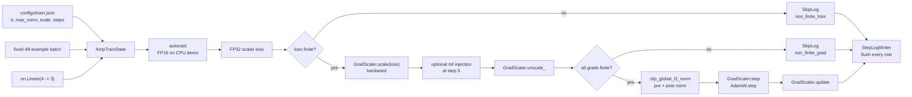

# Gradient Clipping and Mixed Precision

A production-shaped training step for the two safety belts that keep a run alive:
global L2 gradient clipping and a mixed-precision `autocast` + `GradScaler` loop
that detects non-finite losses and gradients, skips the optimizer update, halves
the scale, and logs the evidence.

The module is self-contained: no sibling-module imports, no network call in the
tests, no GPU requirement, no dataset download, and no provider API. PyTorch
2.15.0+cpu is pinned; the demo is a deterministic 20-step `nn.Linear` run that
injects an Inf gradient at step index 5 and prints one `SKIP` row.

## Training-step contract

The order is the lesson:

```python
with autocast(device_type, dtype):
    logits = model(inputs)
    loss = cross_entropy(logits, targets)

if not isfinite(loss):
    scaler.scale(loss)              # lazily initialize the scale
    scaler.update(new_scale=scale * backoff)
    return SkipLog("non_finite_loss")

scaler.scale(loss).backward()
# optional demo injection happens here, before unscale
scaler.unscale_(optimizer)
if has_non_finite_grad(parameters):
    scaler.update()                 # recorded inf check halves the scale
    return SkipLog("non_finite_grad")

pre, post = clip_global_l2_norm(parameters, max_norm)
scaler.step(optimizer)
scaler.update()
```

Clipping before `unscale_` would compare the threshold against scaled gradients.
`scaler.step` before clipping would apply unclipped values. `scaler.update` must
run on clean and skipped steps; omitting it produces the classic "scale never
changes" bug.

`clip_global_l2_norm` wraps `torch.nn.utils.clip_grad_norm_` and returns both the
pre-clip norm (the function's return value) and a freshly measured post-clip norm,
plus a `clipped` flag. `has_non_finite_grad` scans every non-`None` gradient with
`torch.isfinite`. The global norm casts gradients to float32 before squaring so a
large float16 gradient cannot overflow in the intermediate square.

`AmpTrainState` owns the model, `AdamW`, `GradScaler`, autocast device, and
autocast dtype. Its `step(inputs, targets)` validates the batch, sets the
optimizer learning rate, runs forward/backward, performs the checks, and returns
either a `StepLog` or a `SkipLog`. `global_step` advances on skipped steps too;
it is the schedule/data cursor, not the optimizer-update count.

## Architecture



| Component | Responsibility |
| --- | --- |
| `TrainConfig` / `load_train_config` | Validates the nine-key JSON source of truth; rejects missing, unknown, and non-finite values. |
| `global_grad_l2_norm` | Euclidean norm of the concatenated gradient vector in float32. |
| `has_non_finite_grad` | NaN/Inf scan over all parameter gradients. |
| `clip_global_l2_norm` | In-place global L2 clipping plus pre/post norm reporting. |
| `AmpTrainState` | The full autocast, scaling, unscale, clipping, skip, step, update pipeline. |
| `StepLog` / `SkipLog` | Structured records for successful and refused updates. |
| `StepLogWriter` | Fixed-schema CSV writer that flushes the header and every row. |
| `SkipRateMonitor` | Rolling-window skip rate with a latched consecutive-step alert. |
| `run_demo` / `main` | Deterministic demo, artifacts, and CLI. |

## Quickstart

Prerequisites: [`uv`](https://docs.astral.sh/uv/) and Python 3.11+.

```bash
cd 45-gradient-clipping-amp
uv sync --frozen --all-groups
uv run --frozen python code/main.py
```

The default run trains for 20 updates and writes:

```text
outputs/demo/training_log.csv
outputs/demo/run_config.json
```

Run the full gate (dependency sync, tests, strict mypy, default demo):

```bash
./verify.sh
```

`verify.sh` is idempotent: the demo overwrites its own artifacts. `outputs/`,
`.venv/`, and caches are git-ignored.

Useful overrides:

```bash
uv run --frozen python code/main.py --steps 8 --seed 11 --workdir outputs/run-8
uv run --frozen python code/main.py --no-inject --bf16 --workdir outputs/bf16
uv run --frozen python code/main.py --device cuda --workdir outputs/cuda
```

`--steps` may be shorter or longer than the config; if the injected step lies
outside the run, that run simply has no skip. The demo requirement (one skip in
20 rows) applies to the default configuration.

## Configuration

`configs/train.json` is the committed source of truth:

```json
{
  "lr": 0.1,
  "max_grad_norm": 0.5,
  "init_scale": 65536.0,
  "growth_interval": 4,
  "backoff_factor": 0.5,
  "steps": 20,
  "seed": 7,
  "inject_inf_step": 5,
  "autocast_dtype": "float16"
}
```

Rules enforced by `TrainConfig`:

- `lr >= 0`; `max_grad_norm > 0`; `init_scale > 0`; all finite.
- `growth_interval >= 1`; `0 < backoff_factor < 1`.
- `steps >= 1`; `seed >= 0`.
- `inject_inf_step` is `null` or a nonnegative integer.
- `autocast_dtype` is exactly `"float16"` or `"bfloat16"`.
- The loader requires exactly the nine keys; a typo cannot silently fall back to
  a default. Booleans are rejected where integers are expected.

`max_grad_norm = 0.5` is deliberately tight for a 20-step demo; it makes clipping
visible in the first steps. The production discussion below uses the common
`1.0` default. The batch has three Gaussian clusters centered at `±4` on two axes,
so early gradient norms are around 1.3 and the clip is exercised.

CLI flags override config values for one run: `--steps`, `--seed`, `--device`,
`--bf16`, `--no-inject`, and the skip-rate alert parameters. `run_config.json`
records the effective values, including the device and precision, so a run
directory is self-describing.

## Per-step log and canonical CSV

The console prints one tagged row per step:

```text
STEP step=000 lr=0.100000 loss=0.599783 grad_pre=1.328672 grad_post=0.500000 scale=65536.0 clipped=yes
...
SKIP step=005 lr=0.100000 loss=0.070631 reason=non_finite_grad grad_pre=inf scale=131072.0
...
```

`training_log.csv` has the fixed canonical columns:

```text
step,lr,grad_l2_pre_clip,grad_l2_post_clip,loss,skipped,skip_reason,scaler_scale
```

Rules:

- `skipped` is `0` or `1`; `skip_reason` is `non_finite_loss`,
  `non_finite_grad`, or empty.
- `grad_l2_post_clip` is empty on every skipped step because no clipped update
  is applied.
- `grad_l2_pre_clip` is empty only for a non-finite loss (no backward pass
  happened). A non-finite gradient keeps its measured `inf` or `nan` value.
- `scaler_scale` is the factor used for that step's loss scaling, read before
  `scaler.update`. The next row therefore shows the half/double transition.
- `clipped` is available on `StepLog` in memory but is not an extra CSV column;
  the canonical schema is fixed.

`StepLogWriter` writes and flushes the header on entry, then flushes after every
row. A Ctrl-C or Python exception leaves every completed row on disk. This is a
process-interruption guarantee, not a power-loss guarantee; there is no `fsync`.

## Skip-rate alerting

A skip is healthy in isolation. The monitor turns a stream of them into an
operational signal:

- `SkipRateMonitor(window=1000, threshold=0.05, fail_after=100)`.
- The rate is `skips / observed_steps` over the most recent `window` events.
- No alert is raised until the window is full.
- Once full, each step with `rate > threshold` increments a consecutive counter;
  any step at or below the threshold resets it.
- `alerted` latches after `fail_after` consecutive above-threshold steps.

`--fail-on-skip-rate` prints the report, writes the CSV, then exits 1 when the
alert is active. The default demo finishes at 1 skip / 20 steps = 0.05, which is
not *above* the 0.05 threshold, so the default exits 0.

## What runs offline

Everything:

- The model, batch, clipping, scaler pipeline, CSV writer, and report are local
  Python.
- The batch is generated from a fixed seed; no dataset or corpus is read.
- Tests use tiny in-memory modules and `tmp_path`; they do not open sockets or
  call external services.
- Dependency installation is the only network step, and it uses the pinned CPU
  PyTorch index and `uv.lock`.

## CPU mixed precision and the pinned GradScaler

The source lesson says the CPU `GradScaler` is a stub. In the pinned
`torch 2.15.0+cpu` build it is **not** disabled: `GradScaler("cpu").is_enabled()`
is true, `get_scale()` reports the factor, `unscale_` records Inf/NaN, and
`update()` halves or doubles it. The demo and tests assert that behavior.

The important CPU limitation is separate: under CPU autocast, `nn.Linear` keeps
its parameters and received gradients in FP32; only eligible matmul-class
outputs are cast. CPU loss scaling is therefore plumbing rather than underflow
protection, and no FP16 parameter-gradient overflow occurs. The deterministic
skip in the demo is an explicitly injected Inf after backward, not a claim that
CPU FP16 arithmetic naturally overflowed. On CUDA, the same call sites operate
on FP16 gradients and the scaler's numerical purpose is real.

## Optional CUDA mode

`--device cuda` moves the model and batch to CUDA and constructs
`GradScaler("cuda", ...)`; `autocast` uses the same dtype from the config or
`--bf16`. The pinned wheel is CPU-only, so this path is not run or measured here.
To use it, install a CUDA build of PyTorch 2.15 from the wheel index for your
toolkit, update the lockfile, and keep the same source:

```text
# after replacing the CPU torch wheel with a CUDA build of the same version
uv lock
uv run --frozen python code/main.py --device cuda --workdir outputs/cuda
```

No CUDA accuracy or throughput result is claimed. The real-corpus integration is
also not implemented: the loop accepts any 2-D floating inputs and 1-D `long`
targets, so a causal-LM batch would replace `make_demo_batch` and `cross_entropy`
would become the language-model loss; the clipping and scaler wiring do not
change.

## Measured results

Measured locally on CPU with Python 3.14.10 and `torch 2.15.0+cpu`, using the
committed config and seed 7:

| Measurement | Result |
| --- | --- |
| Default demo steps | 20 |
| Tagged `STEP` rows | 19 |
| Tagged `SKIP` rows | 1 (step 5, `non_finite_grad`) |
| First logged loss | 0.599783 |
| Final logged loss | 0.007854 |
| Maximum pre-clip norm | `inf` on the skipped step |
| Scale before skip | 131072.0 |
| Scale after skip / on next row | 65536.0 |
| Final scale | 524288.0 |
| Training CSV rows | 20 data rows |
| Tests | 28 passed |
| Strict mypy | no issues in 7 checked source files |

Representative rows from the generated CSV:

```text
step,lr,grad_l2_pre_clip,grad_l2_post_clip,loss,skipped,skip_reason,scaler_scale
0,0.1,1.3286720514297485,0.4999996237455383,0.5997830033302307,0,,65536.0
5,0.1,inf,,0.07063054293394089,1,non_finite_grad,131072.0
6,0.1,0.13639889657497406,0.13639890092621007,0.07063054293394089,0,,65536.0
19,0.1,0.01027352549135685,0.010273525083326273,0.007854209281504154,0,,524288.0
```

The skipped step leaves the loss unchanged, because no optimizer update is
applied; step 6 is the first update after recovery. Rerunning the same command
reproduces the artifacts byte for byte.

## Limitations

- The model is a 15-parameter linear classifier, not a transformer or language
  model; the numbers prove wiring, not model quality.
- CPU autocast keeps parameter gradients in FP32, so the demo's skip is synthetic
  rather than evidence of real CPU FP16 overflow.
- The loss-spike path is covered by a non-finite-loss test model, not by the
  default demo. The demo exercises the gradient-Inf path requested by the lesson.
- On a non-finite loss there is no backward pass to record a scaler Inf check, so
  the code halves via `scaler.update(new_scale=...)`. That does not reset the
  scaler's growth tracker; the normal gradient-skip and clean paths use
  `unscale_` + `update()` and do reset it. This is documented rather than hidden.
- The CSV flush is not an `fsync`; it protects against process interruption, not
  power loss.
- No CUDA run, throughput benchmark, distributed training, gradient
  accumulation, checkpoint resume, or real-corpus evaluation is implemented.
- `inject_inf_step` is a deterministic demo/test control. It is not a production
  feature; production overflow comes from the numerical range, not from code
  writing an Inf into a gradient.
- The skip-rate alert is exercised with tiny windows in tests; the default
  1,000-step window would need a longer run than the 20-step demo to fill.

## References

1. Paulius Micikevicius et al., "Mixed Precision Training," arXiv:1710.03740.
   <https://arxiv.org/abs/1710.03740>
2. Razvan Pascanu, Tomas Mikolov, Yoshua Bengio, "On the difficulty of training
   Recurrent Neural Networks," arXiv:1211.5063.
   <https://arxiv.org/abs/1211.5063>
3. PyTorch 2.15 documentation, "Automatic Mixed Precision examples" (unscale
   before clipping; `scaler.step`/`scaler.update` order).
   <https://docs.pytorch.org/docs/2.15/notes/amp_examples.html>
4. PyTorch 2.15 documentation, "Automatic Mixed Precision package - torch.amp"
   (autocast dtypes, CPU guidance, GradScaler semantics).
   <https://docs.pytorch.org/docs/2.15/amp.html>
5. PyTorch 2.15 documentation, `torch.nn.utils.clip_grad_norm_`.
   <https://docs.pytorch.org/docs/2.15/generated/torch.nn.utils.clip_grad_norm_.html>

## License

MIT. See [LICENSE](LICENSE).
