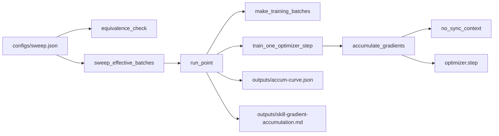

# Gradient Accumulation

Train at an effective batch of 512 on a CPU that can only hold 8 examples per
forward pass. The module runs 64 micro-batches, scales each loss by
`1 / accum_steps`, accumulates gradients in the parameter buffers, and steps the
optimizer once.

The artifact is deliberately mechanical: it proves the equivalence, exercises the
sync-on-last-step pattern, and reports the throughput trade as JSON. It is not a
study of large-batch optimization or learning-rate scaling.

## The contract

```python
optimizer.zero_grad(set_to_none=True)
for index, (inputs, targets) in enumerate(micro_batches):
    is_last = index == len(micro_batches) - 1
    context = (
        contextlib.nullcontext()
        if is_last or not hasattr(model, "no_sync")
        else model.no_sync()
    )
    with context:
        loss = mean_cross_entropy(model(inputs), targets)
        (loss / len(micro_batches)).backward()
optimizer.step()
```

Four invariants make this equivalent to one full-batch backward:

1. **Zero once per effective step.** The gradient buffer is cleared before the
   first micro-batch, never between micro-batches.
2. **Scale every mean-reduced loss by `1 / accum_steps`.** PyTorch sums into
   `parameter.grad`; dividing each chunk restores the full-batch scale. The loss
   reduction must be `mean` over samples. A summed criterion needs its own
   normalization by total items, not this division.
3. **Use one optimizer step.** Momentum buffers and AdamW moments advance once per
   effective batch, not once per micro-batch.
4. **Synchronize on the last micro-batch.** For the first `N - 1` micro-batches,
   the forward, loss, and backward run inside `no_sync()`. The final micro-batch
   runs outside it, so DDP performs one gradient all-reduce for the whole
   accumulated buffer. PyTorch documents that the forward must be inside the
   context or gradients still synchronize.

The counters in this module count collective points, not context exits:

- `sync_calls` is **1 per effective step**.
- `skipped_syncs` is **N - 1 per effective step**.
- For 12 sweep steps and 64 accumulation steps, the JSON reports
  `sync_calls = 12` and `skipped_syncs = 756`.

This is accumulation loss scaling, not AMP `GradScaler`. The division is
mathematical: it makes the accumulated gradient match a full-batch gradient. AMP
scaling protects numerics and has a different unscale/step order; no AMP path is
included here.

## Architecture



| Component | Responsibility |
| --- | --- |
| `SweepConfig` / `load_config` | Validates the eleven-key JSON source of truth; rejects missing, unknown, non-finite, boolean-as-integer, and unsorted-accumulation values. |
| `make_blobs` / `build_model` | Deterministic three-class Gaussian blobs and a 6 -> 16 -> 3 tanh MLP. |
| `effective_batch_size` | Implements `micro_batch * accum_steps * world_size`. |
| `chunk_micro_batches` | Splits an equal-size batch into accumulation chunks; rejects uneven tails. |
| `no_sync_context` | No-op for a plain module; routes to `no_sync()` for a DDP-like wrapper. |
| `accumulate_gradients` | Zeroes once, scales by `1/N`, wraps non-final micros, and returns loss/gradient counters. |
| `train_one_optimizer_step` | Adds exactly one `optimizer.step()`. |
| `equivalence_check` | Compares gradients before the step and parameters after against a full-batch reference. |
| `run_point` / `sweep_effective_batches` | Times optimizer steps and collects the curve. |
| `write_curve` / `write_skill` | Fixed-schema JSON and a deterministic reusable recipe. |
| `main` | CLI with exit 0 on success, 1 on failed evidence, 2 on invalid input. |

## Quickstart

Prerequisites: [`uv`](https://docs.astral.sh/uv/) and Python 3.11+.

```bash
cd 46-gradient-accumulation
uv sync --frozen --all-groups
uv run --frozen python code/main.py
```

The default run prints the equivalence line, the seven-row curve, and:

```text
outputs/accum-curve.json
outputs/skill-gradient-accumulation.md
```

Run the complete gate (dependency sync, tests, strict mypy, default demo):

```bash
./verify.sh
```

`verify.sh` is idempotent: the demo overwrites its own artifacts. `outputs/`,
`.venv/`, and caches are git-ignored.

Useful overrides:

```bash
uv run --frozen python code/main.py --num-steps 20 --workdir outputs/exercise
uv run --frozen python code/main.py --accum-steps 1,4,16 --micro-batch 8
uv run --frozen python code/main.py --optimizer adamw --lr 0.01
```

The default configuration uses SGD with momentum, because the sweep is a
throughput exercise rather than an optimizer comparison. AdamW is available for
the cadence test and the CLI.

## Configuration

`configs/sweep.json` is the committed source of truth:

```json
{
  "micro_batch": 8,
  "accum_steps": [1, 2, 4, 8, 16, 32, 64],
  "num_steps": 12,
  "lr": 0.1,
  "momentum": 0.9,
  "optimizer": "sgd",
  "seed": 7,
  "input_dim": 6,
  "hidden_dim": 16,
  "num_classes": 3,
  "noise": 0.7
}
```

Rules enforced by `SweepConfig`:

- Positive `micro_batch`, `num_steps`, `input_dim`, `hidden_dim`, and
  `num_classes`; nonnegative `seed`.
- `accum_steps` is a nonempty tuple of positive integers, strictly increasing.
- `lr > 0`; `0 <= momentum < 1`; `noise > 0`; all finite.
- `optimizer` is exactly `"sgd"` or `"adamw"`; `input_dim >= num_classes`.
- The loader requires exactly the eleven keys. A typo cannot silently fall back to
  a default, and JSON booleans are not accepted as integers.

The identity is:

```text
effective_batch = micro_batch * accum_steps * world_size
```

With `micro_batch = 8` and `world_size = 1`, the committed sweep covers effective
batches 8 through 512. Doubling `accum_steps` doubles the samples per optimizer
step and approximately doubles the wall time per step; it does not reduce the work.

CLI flags override the config for one run. `--accum-steps` is a comma-separated
list; overrides are reconstructed through `SweepConfig`, so validation is not
bypassed. Invalid configuration exits 2 before creating the output directory.

## Equivalence evidence

`equivalence_check` builds one model, deep-copies it so both copies start with
bit-identical parameters, and gives both the same SGD/AdamW optimizer setup. The
full copy sees all 16 samples in one forward pass. The accumulated copy sees four
4-sample chunks, with each mean loss divided by four. The function compares:

- gradient buffers **before** either optimizer steps;
- the reported mean loss;
- parameters **after** one identical optimizer step.

The assertion tolerance is fixed at `1e-4`, as specified. The default demo prints:

```text
equivalence: batch=16 accum=4 grad_max_abs_diff=1.490e-08 param_max_abs_diff=1.490e-08 loss_abs_diff=7.451e-08 tolerance=1e-04 passed=yes
```

The three differences sit four orders of magnitude below the tolerance. The result
depends on equal chunk sizes and a mean-reduced loss; both are enforced/documented
rather than assumed silently.

## Throughput sweep

For each `accum_steps` value, `run_point`:

1. rebuilds the model from the same seed and creates a fresh optimizer;
2. generates `micro_batch * accum_steps * num_steps` samples outside the timed
   region;
3. times only `train_one_optimizer_step` for each of `num_steps` effective steps;
4. reports total samples divided by summed step time, the median effective-step
   wall time, and the loss summaries.

Each point makes the same number of optimizer steps (12). A larger accumulation
point therefore sees more samples and a different loss trajectory; the loss columns
show that the loop trains, not a controlled quality comparison. The curve is about
throughput, not about which effective batch generalizes better.

The JSON is a stable schema (`schema_version: 1`) with one object per point:

```text
accum_steps, micro_batch, effective_batch, world_size, num_steps,
micro_batches, optimizer_steps, sync_calls, skipped_syncs, samples,
wall_time_sec, samples_per_sec, median_step_ms, first_loss, avg_loss, final_loss
```

The skill recipe at `outputs/skill-gradient-accumulation.md` is generated from the
same config and contains no timings, so two runs produce the same recipe.

## Measured results

Measured locally on CPU with Python 3.14.10 and `torch 2.15.0+cpu`, using the
committed config and seed 7. Timings are single-machine and noisy; reruns change
the throughput columns.

| Accum | Effective batch | Samples | Samples/s | Median step (ms) | Sync calls | Skipped syncs | Avg loss |
| ---: | ---: | ---: | ---: | ---: | ---: | ---: | ---: |
| 1 | 8 | 96 | 25,309.8 | 0.298 | 12 | 0 | 0.347340 |
| 2 | 16 | 192 | 25,308.1 | 0.595 | 12 | 12 | 0.354774 |
| 4 | 32 | 384 | 43,787.8 | 0.691 | 12 | 36 | 0.354014 |
| 8 | 64 | 768 | 52,223.9 | 1.186 | 12 | 84 | 0.348410 |
| 16 | 128 | 1,536 | 55,583.9 | 2.162 | 12 | 180 | 0.347153 |
| 32 | 256 | 3,072 | 57,142.8 | 4.190 | 12 | 372 | 0.344539 |
| 64 | 512 | 6,144 | 61,130.6 | 8.222 | 12 | 756 | 0.343752 |

In the same run, the test suite reported **44 passed** and strict mypy reported
**no issues in 7 source files**.

Reading the curve:

- From effective batch 8 to 512, median step time grows about 27.6x while the work
  per step grows 64x. Accumulation amortizes fixed per-step Python/optimizer
  overhead, so samples/second improves before it flattens.
- The last doubling (256 to 512) buys about 7% more samples/second while the median
  step time nearly doubles. That is the diminishing return: wall time scales with
  accumulation, while throughput approaches the machine's limit.
- This is a tiny MLP, so Python dispatch dominates more than it would in a large
  transformer. The absolute numbers are not a hardware benchmark.

## What runs offline

Everything except dependency installation:

- the model, blob dataset, optimizer, accumulation loop, equivalence check, sweep,
  JSON writer, and skill recipe are local Python;
- no dataset download, provider API, socket, GPU, or process group is used;
- tests use in-memory tensors and `tmp_path`; they make no network calls;
- `uv sync` is the only network step and uses the pinned CPU PyTorch index plus the
  committed `uv.lock`.

PyTorch 2.15 emits a harmless "Failed to initialize NumPy" warning in this
environment because NumPy is not a dependency and no code path uses it. It does not
affect the results.

## Optional CUDA / DDP mode

The pinned wheel is CPU-only, so no CUDA measurement is claimed. The loop is
device-agnostic after moving the model and batches:

```python
device = torch.device("cuda")
model = build_model(config).to(device)
batches = [
    [(inputs.to(device), targets.to(device)) for inputs, targets in step]
    for step in make_training_batches(config, accum_steps)
]
optimizer = make_optimizer(model, config)  # construct after the move
```

For real distributed data parallel training, initialize a process group, wrap the
model with `torch.nn.parallel.DistributedDataParallel`, and use
`torch.distributed.get_world_size()` for the effective-batch identity.
`no_sync_context` already detects the wrapper's `no_sync` method, so the loop shape
does not change. The committed sweep reports `world_size = 1` because it runs one
local process; it does not simulate a multi-rank speedup.

The PyTorch documentation's `no_sync` example and the Accelerate accumulation guide
both describe this pattern. See the references below.

## Limitations

- **Equal micro-batch sizes only.** The module raises on an uneven tail. The
  correct tail fix is scaling each micro loss by `micro_size / total_size`, not
  dividing every chunk by `accum_steps`.
- **Mean-reduced loss only.** The equivalence proof relies on the per-sample mean.
  Token-level causal-LM losses need total loss divided by total non-padding tokens;
  HF's 2024 fix documents that failure mode.
- **World size fixed at 1.** No process group is created; DDP is exercised through a
  deterministic fake adapter, not a multi-process run.
- **Tiny synthetic model.** The numbers prove the wiring and the throughput trade,
  not transformer or language-model quality.
- **No scheduler, AMP, checkpoint/resume, or real corpus.** The loop is the lesson;
  integration with those systems is intentionally not built here.
- **One-step exact equivalence.** The check compares one full-batch step. It does
  not run a long convergence experiment.
- **Single-machine timing.** Median step time reduces outlier noise but does not
  remove CPU frequency, scheduler, or cgroup variation.
- **No linear learning-rate scaling.** Goyal et al. motivate scaling the learning
  rate with effective batch; this module fixes one optimizer configuration across
  the sweep, so the loss columns are not a large-batch optimization study.

## Design decisions

- **Scale before backward, not after.** PyTorch accumulates into `.grad` by
  summing; dividing each mean loss by `accum_steps` gives the full-batch gradient
  scale without a second pass over the buffers.
- **Wrap forward and backward together.** `no_sync()` must enclose the forward or
  DDP still communicates; the test model records forwards inside the context.
- **Count collectives, not exits.** `sync_calls = 1` and
  `skipped_syncs = N - 1` make the output match the cost model rather than the
  number of Python context-manager exits.
- **Zero at the start of the effective step.** This makes stale gradients
  impossible and matches the contract a real training loop needs.
- **Synthetic blobs, not a downloaded corpus.** A fixed generator makes the
  equivalence and JSON reproducible offline; the lesson is the accumulation loop,
  not dataset quality.
- **Data generation outside the timer.** `samples_per_sec` measures forward,
  backward, zeroing, and optimizer step, not fixture creation.
- **Fresh model per point.** Every accumulation setting starts from the same
  parameters and optimizer state, so throughput is not measuring different
  trajectories.
- **Generated skill recipe without timings.** The recipe is reusable and
  byte-reproducible; timing evidence lives only in the JSON.

## References

1. AI Engineering from Scratch, "Gradient Accumulation" capstone specification.
   <https://aiengineeringfromscratch.com/learn/capstone-projects/gradient-accumulation>
2. PyTorch 2.15 documentation, `torch.nn.parallel.DistributedDataParallel`,
   including `no_sync()` and the warning that the forward must be inside the
   context.
   <https://docs.pytorch.org/docs/2.15/generated/torch.nn.parallel.DistributedDataParallel.html>
3. Hugging Face Accelerate documentation, "Performing gradient accumulation with
   Accelerate" (loss division, `no_sync` on non-final batches, variable-size
   caveat).
   <https://huggingface.co/docs/accelerate/main/en/usage_guides/gradient_accumulation>
4. Lysandre et al., "Fixing Gradient Accumulation," Hugging Face blog, 2024
   (total loss divided by total non-padding tokens; why per-batch averages fail).
   <https://huggingface.co/blog/gradient_accumulation>
5. Priya Goyal et al., "Accurate, Large Minibatch SGD: Training ImageNet in 1
   Hour," arXiv:1706.02677 (linear learning-rate scaling and warmup for large
   effective batches).
   <https://arxiv.org/abs/1706.02677>

## License

MIT. See [LICENSE](LICENSE).
