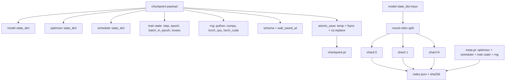

# Checkpoint Save and Resume

A training run that saves only weights loses the optimizer's learned moments, the
scheduler's position, the data cursor, and the random state that produced the next
dropout mask. Resume then produces a different loss curve on the same model and
data. This module builds the full-state checkpoint that fixes that: one payload
with model, optimizer, scheduler, counters, loss history, and Python/NumPy/PyTorch
RNG state, written atomically, plus a hash-verified sharded layout for larger
models.

The demo trains a tiny dropout MLP, saves after step 7 (mid-epoch), hands the
checkpoint to a **fresh interpreter**, and continues. The resumed losses match the
uninterrupted baseline exactly in the measured run.

## Architecture



| Component | Responsibility |
| --- | --- |
| `capture_rng_state` / `restore_rng_state` | Round-trip Python, NumPy, Torch CPU, and Torch CUDA RNG state as plain Python values. |
| `atomic_save` / `atomic_write_json` | Same-directory unique temp file, file fsync, `os.replace`, directory fsync. |
| `TrainState` | Immutable `step`, `epoch`, `batch_in_epoch`, `batches_per_epoch`, and loss history with validation. |
| `save_checkpoint` / `load_checkpoint` | Single-file full-state payload; loader uses `torch.load(..., weights_only=True)`. |
| `save_sharded_checkpoint` / `load_sharded_checkpoint` | Round-robin shards, SHA-256 index, path containment, verify-all-before-merge. |
| `run_resume_demo` | Baseline versus mid-epoch resume in a subprocess; returns a report with both max-diff cases. |
| `main` | CLI, error codes, report and skill artifact generation. |

## Quickstart

Prerequisites: [`uv`](https://docs.astral.sh/uv/) and Python 3.11+.

```bash
cd 47-checkpoint-save-resume
uv sync --frozen --all-groups
uv run --frozen python code/main.py
```

The default demo prints the configuration, RNG sources, baseline losses, and the
single-file and sharded resume results. It writes:

```text
outputs/checkpoint.pt
outputs/checkpoint-sharded/index.json
outputs/checkpoint-sharded/meta.<generation>.pt
outputs/checkpoint-sharded/model.shard-000.<generation>.pt
outputs/checkpoint-sharded/model.shard-001.<generation>.pt
outputs/checkpoint-sharded/model.shard-002.<generation>.pt
outputs/demo-config.json
outputs/resume-demo.json
outputs/skill-checkpoint-save-resume.md
```

Run the complete gate (dependency sync, tests, strict mypy, default demo):

```bash
./verify.sh
```

`verify.sh` is safe to run twice. The demo atomically replaces its JSON/checkpoint
targets; shard generations are immutable and remain on disk between runs.

Useful overrides (all validated before the workdir is created):

```bash
uv run --frozen python code/main.py --workdir outputs/short \
    --total-steps 6 --interrupt-at 3 --shards 2
uv run --frozen python code/main.py --seed 11
```

Invalid configuration exits 2; a failed resume/IO operation exits 1; success exits 0.

## What is saved

| Bucket | Payload field | Why it matters |
| --- | --- | --- |
| Model | `model` | Parameters and buffers. |
| Optimizer | `optimizer` | AdamW moments; without them the next update is a different optimization problem. |
| Scheduler | `scheduler` | Learning-rate position, including cosine progress. |
| Train counters/losses | `train_state` | `step`, `epoch`, `batch_in_epoch`, `batches_per_epoch`, and the loss history. |
| RNG | `rng` | Python `random`, NumPy legacy global RNG, Torch CPU, and Torch CUDA states. |
| Metadata | `schema`, `wall_saved_at` | Format hook and human-readable save time. |

Payload shape (single file):

```python
{
    "schema": "checkpoint/v1",
    "model": model.state_dict(),
    "optimizer": optimizer.state_dict(),
    "scheduler": scheduler.state_dict(),
    "train_state": {
        "step": step,
        "epoch": epoch,
        "batch_in_epoch": batch_in_epoch,
        "batches_per_epoch": batches_per_epoch,
        "losses": list(losses),
    },
    "rng": capture_rng_state(),
    "wall_saved_at": time.time(),
}
```

The schema string is the migration hook. The loader dispatches on `checkpoint/v1`
and rejects unknown versions instead of silently guessing.

## Atomic save

Writing into the final filename is a bug: a crash mid-write leaves a corrupt file
that the next resume reads. `_atomic_write` instead:

1. creates the target's parent directory;
2. creates a unique temp file **in the same directory** with `tempfile.mkstemp`;
3. lets the writer (`torch.save` or JSON) run against that handle;
4. flushes and `os.fsync`s the file;
5. calls `os.replace(temp, target)`;
6. `os.fsync`s the directory descriptor.

The rename is atomic on POSIX (`rename(2)`), and the directory fsync is what makes
the new name durable after a reboot; fsync on the file alone does not guarantee the
directory entry. A kill before the rename leaves the old target untouched. A kill
after the rename leaves the new target complete. The temp name is unique per
attempt, so two writers cannot stomp each other.

The test suite proves the crash window with a subprocess that writes partial bytes,
fsyncs them, and calls `os._exit(17)` before `os.replace`: the old checkpoint stays
byte-identical and loadable, and only an unreferenced temp file remains. A second
test simulates a failing `torch.save` and asserts the temp is cleaned up. A kill
can leave an orphan temp file; it is never read as a checkpoint.

## RNG capture and restore

The checkpoint stores only plain Python numbers, lists, and dictionaries:

```python
{
    "python": {"version": 3, "state": [...], "gauss_next": None},
    "numpy": {
        "bit_generator": "MT19937",
        "key": [...],             # np.random.get_state()[1].tolist()
        "pos": 624,
        "has_gauss": 1,
        "cached_gaussian": 0.123,
    },
    "torch_cpu": [...],           # torch.get_rng_state().tolist()
    "torch_cuda": [],             # one list per GPU, empty on CPU-only
}
```

This is deliberate. `torch.load(..., weights_only=True)` accepts tensors and
primitive containers, but rejects arbitrary globals; NumPy arrays and tuples are
not needed. The NumPy Gaussian cache is part of the state (`has_gauss` /
`cached_gaussian`), so restoring and drawing the next normal value matches the
uninterrupted stream. On restore, every field is validated before any RNG is
mutated. CUDA state present in a checkpoint but unavailable on the resuming host
raises `ValueError` instead of silently changing the trajectory.

## Security and integrity

- `load_checkpoint` and every shard/meta load call
  `torch.load(..., map_location="cpu", weights_only=True)` explicitly. A `.pt`
  file is a pickle; the weights-only unpickler does not execute arbitrary globals.
- Torch is pinned to **2.15.0+cpu**. The weights-only guarantee this module relies
  on is only valid from Torch 2.6 onward; CVE-2025-32434 bypassed it in earlier
  releases.
- Schema, mapping types, counters, RNG lengths/byte ranges, SHA-256 values, and
  path containment are checked with `ValueError`, not `assert`. `python -O` strips
  assertions and must not weaken checkpoint validation.
- The sharded loader resolves every index path inside the checkpoint directory,
  rejects absolute paths, `..` escapes, and symlinks that resolve outside, verifies
  **all** hashes before merging any shard, and rejects duplicate keys.
- SHA-256 detects truncation and accidental corruption. It is not a signature: an
  attacker who can rewrite both a shard and the index can rewrite the hash. Use a
  trusted transport or signatures if the checkpoint crosses a trust boundary.

## Sharded layout

`save_sharded_checkpoint` splits `model.state_dict().items()` round-robin across
`N` shard files. Each save gets a unique generation token, so the new files are
immutable and the index is the atomic commit point:

```text
checkpoint-sharded/
  index.json
  meta.step00000007-a368109ee5a7.pt
  model.shard-000.step00000007-a368109ee5a7.pt
  model.shard-001.step00000007-a368109ee5a7.pt
  model.shard-002.step00000007-a368109ee5a7.pt
```

`index.json`:

```json
{
  "schema": "checkpoint-index/v1",
  "shard_count": 3,
  "shards": [
    {"file": "model.shard-000.step00000007-a368109ee5a7.pt", "sha256": "..."},
    {"file": "model.shard-001.step00000007-a368109ee5a7.pt", "sha256": "..."},
    {"file": "model.shard-002.step00000007-a368109ee5a7.pt", "sha256": "..."}
  ],
  "meta": {
    "file": "meta.step00000007-a368109ee5a7.pt",
    "sha256": "..."
  }
}
```

The meta payload carries the schema, `shard_count`, optimizer, scheduler, train
state, RNG, and `wall_saved_at`. The loader cross-checks the index and meta counts,
then verifies every shard and meta hash before loading anything. A crash before the
index replace leaves the old index and old generation valid; a crash after it leaves
the new generation complete. Old generations and crashed-save orphans are not
deleted automatically because a concurrent reader may still be using the old index.

## Resume demo and mid-epoch cursor

The demo uses:

- a 6 → 12 → 2 MLP with ReLU and dropout 0.2;
- 32 synthetic two-class samples, 8 per batch, 4 batches per epoch;
- AdamW (`lr=0.05`) and `CosineAnnealingLR(T_max=12)`;
- 12 steps, interruption after step 7.

Each step consumes randomness in a fixed order: NumPy noise for the batch, a
Python uniform scale, then Torch dropout in the forward pass. That makes all three
RNG sources observable in the loss trajectory.

At step 7 the state is `epoch=1`, `batch_in_epoch=3`, `step=7`. The checkpoint's
RNG is already the state **after** the consumed batches, so resume restores it and
jumps the data cursor to `(epoch, batch_in_epoch)` without replaying skipped draws.
This is the exact-state form of the "fast-forward" requirement: the next batch,
noise, scale, and dropout mask match the uninterrupted run.

A fresh interpreter (`python code/main.py worker ...`) constructs a new model,
seeds all three RNGs with a different seed, consumes unrelated draws, then loads
each checkpoint. Loading the checkpoint restores the training RNG and weights; the
worker runs the remaining `total_steps - step` steps and prints the post-resume
losses. The parent compares them with the baseline after the interruption and
raises if either max absolute difference is not below `1e-4`. Both single-file and
sharded checkpoints are exercised in the same worker process, one after the other.

## Measured results

Measured locally on CPU with Python 3.14.10, `torch 2.15.0+cpu`, and NumPy 2.4.2
(2.4.2 is the newest NumPy 2.x that still supports the project's Python 3.11
floor). Command: `./verify.sh`. The default config/seed is used.

| Metric | Single file | Sharded |
| --- | ---: | ---: |
| Resume max-abs-diff vs baseline | 0.000000 | 0.000000 |
| Tolerance | 1e-4 | 1e-4 |
| Passed | yes | yes |
| Resumed steps | 5 | 5 |
| Checkpoint bytes | 25,011 | 29,551 |
| Shard count | 1 | 3 |
| Index SHA-256 (one run) | — | `cff7fc7e…eb8a60ee` |

Baseline losses over 12 steps: first `0.643667`, mean `0.472059`, final
`0.343606`. The pre-interruption prefix difference is `0.0`. The index hash changes
on every demo run because each shard generation name is unique; the value above is
from the reproduced run that also produced the table. The sharded layout is about
18% larger here because three tiny shards and the meta file each pay ZIP header
overhead; the point is verifiable loading, not compression.

The same run reported **42 passed** tests and strict mypy **no issues in 8 source
files**. The 25 KB single file is mostly the plain-list RNG payload (Torch CPU
state is 5,056 bytes as a list) plus four tiny model tensors and AdamW state.

Reproduce the table from the module root:

```bash
./verify.sh
uv run --frozen python -c \
  "import json; p=json.load(open('outputs/resume-demo.json')); print(p['single']['max_abs_diff'], p['sharded']['max_abs_diff'], p['single']['checkpoint_bytes'], p['sharded']['checkpoint_bytes'])"
```

Reruns regenerate the immutable shard generation, so the index SHA-256 and the
directory file count change; losses, counters, byte sizes, and pass/fail do not.

## What runs offline

Everything except dependency installation:

- model, synthetic dataset, training loop, RNG capture/restore, atomic writes,
  single-file and sharded checkpoints, worker subprocess, JSON report, and skill
  recipe are local Python;
- tests use in-memory tensors and `tmp_path`, and the subprocess tests run local
  Python—no socket, provider API, dataset download, GPU, or process group;
- `uv sync --frozen --all-groups` is the only network step and uses the committed
  lockfile plus the pinned CPU PyTorch index.

## Optional CUDA / GPU mode

The RNG payload already has a `torch_cuda` slot, populated from
`torch.cuda.get_rng_state_all()` when CUDA is visible. Restore requires the same
visible device count; a CPU-only resume of a GPU checkpoint raises `ValueError`.
The pinned wheel is CPU-only and no GPU run or speedup is claimed. To adapt a real
run: construct the model on the target device, load the CPU-mapped checkpoint,
verify that optimizer state tensors landed on the expected device, and restore the
CUDA RNG state before the first post-resume forward pass. Checkpoint hashing and
path containment are device-independent.

## Limitations

- CPU-only measurement and a tiny synthetic MLP; this is a wiring/determinism
  demonstration, not a language-model quality result.
- The demo model has four state-dict entries, so `DemoConfig` allows at most four
  shards. The sharded primitive itself validates against the actual model.
- No distributed sharding or parallel shard reads. Shards are local files split
  round-robin; `torch.distributed.checkpoint` is the production-scale alternative.
- SHA-256 is corruption detection, not authentication; there is no signature or
  keyed MAC.
- The resume worker has a 120-second subprocess timeout; a hang becomes a
  `RuntimeError` with the worker's stderr.
- Old shard generations and orphan temp files are not automatically pruned. A
  concurrent reader may still hold the old index, so deletion is the caller's
  policy; keep the files referenced by the current `index.json` when pruning by
  hand.
- The atomic kill test kills a save subprocess, not a full training process. The
  resume demo uses a real fresh interpreter but does not simulate a kernel reboot.
- No wallclock-triggered save cadence; the demo saves at a step boundary. Add a
  timer at the trainer's periodic-save site for the "every N steps or N minutes,
  whichever first" rule.
- The five spec exercises (parameter-group sharding, last-K pruning, wallclock
  flag, startup corruption scan, v1→v2 migration) are left as extensions; the
  Build It path is implemented end to end.

## Design decisions

- **Unique shard generations instead of fixed shard names.** Fixed names make a
  crash between shard replaces and index replace invalidate the old index. Unique
  immutable files plus an atomic index replace make the old or new checkpoint
  valid at every instant.
- **Verify every hash before loading any shard.** A partial merge that discovers a
  bad later shard wastes work and risks using a mixed generation. Resolution and
  hash verification run in a separate first phase.
- **Plain RNG containers, not pickled NumPy arrays.** The weights-only unpickler
  accepts primitives and tensors; `tolist()` plus explicit casts keeps the security
  boundary intact.
- **CPU `map_location`.** A checkpoint saved on a GPU host should load on a CPU
  host; device placement is the caller's next step.
- **Jump the data cursor; do not replay draws.** The saved RNG is already past the
  consumed batches. Replaying would double-advance the stream and change losses.
- **One fresh worker subprocess.** It proves the checkpoint does not depend on live
  Python state, including in-process RNG or object identity.
- **Explicit `ValueError` validation.** Integrity failures stay visible under
  `python -O`, unlike `assert`.
- **Synthetic blobs and a tiny model.** The demo is deterministic, offline, and
  fast enough for every verification run; the measured result is about state
  restoration, not model quality.

## References

1. AI Engineering from Scratch, "Checkpoint Save and Resume" capstone
   specification. <https://aiengineeringfromscratch.com/learn/capstone-projects/checkpoint-save-resume>
2. PyTorch, "Serialization semantics" (Torch 2.6): `weights_only=True` default,
   accepted primitives, and the safety boundary.
   <https://docs.pytorch.org/docs/2.6/notes/serialization.html>
3. GitHub Advisory Database, "PyTorch: `torch.load` with `weights_only=True` leads
   to remote code execution" (CVE-2025-32434, patched in 2.6.0).
   <https://github.com/advisories/ghsa-53q9-r3pm-6pq6>
4. PyTorch, "Reproducibility": seeding Python, NumPy, and Torch; CUDA determinism
   caveats. <https://docs.pytorch.org/docs/2.6/notes/randomness.html>
5. Linux man-pages, `rename(2)` (atomic replacement) and `fsync(2)` (file and
   directory durability). <https://man7.org/linux/man-pages/man2/rename.2.html>,
   <https://man7.org/linux/man-pages/man2/fsync.2.html>

## License

MIT. See [LICENSE](LICENSE).
