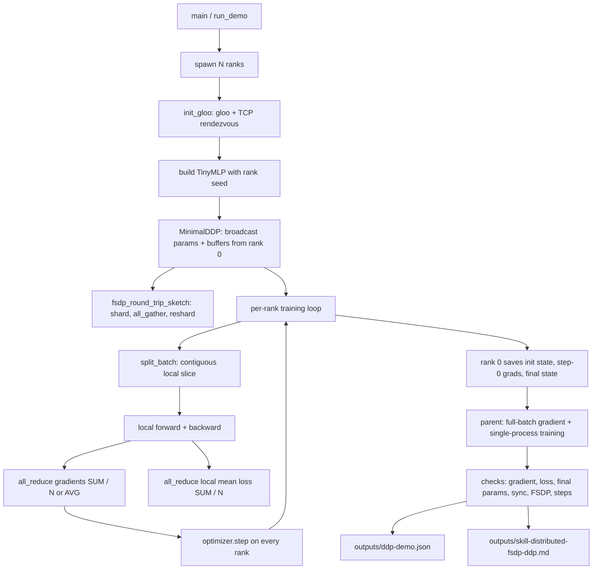

# Distributed Data Parallel and FSDP from Scratch

Multi-rank training is two collectives and one rule: broadcast the model state at
startup, all-reduce and average the gradients after backward, and never let the ranks
disagree about which step they are on. This module builds those pieces over real CPU
processes with PyTorch's `gloo` backend, then proves the result against a single-process
reference on the concatenated batch.

The model and data are deliberately small. The point is the distributed bookkeeping,
not a benchmark: two or more OS processes rendezvous through a TCP store, each sees a
different slice of the same deterministic batch, and the parent process independently
builds the single-process reference from rank 0's serialized initialization and
post-reduce gradient.

## What is actually distributed

- **Process group**: `torch.distributed.init_process_group(backend="gloo")` over
  `MASTER_ADDR=127.0.0.1` and a bind-and-close free port.
- **Parameter/buffer broadcast**: `MinimalDDP.__init__` broadcasts rank 0's parameters
  and buffers. Non-zero ranks intentionally start from different seeds and a divergent
  buffer so the broadcast is observable.
- **Batch sharding**: rank `r` gets a contiguous slice of the full deterministic batch.
  Concatenating the slices in rank order reconstructs the exact input a single process
  uses for the reference.
- **Gradient averaging**: each rank computes a mean loss on its local slice, runs
  backward, then all-reduces every gradient and divides by the world size.
- **Loss averaging**: the local mean loss is all-reduced separately so the reported
  dashboard value is global, not rank-local.
- **FSDP round trip**: every parameter is flattened, zero-padded to a multiple of the
  world size, sliced per rank, all-gathered back into the full tensor, checked
  bit-for-bit against the original, and sliced again to simulate re-sharding.
- **Step agreement**: after training, every rank all-gathers its step counter and the
  run checks that all values match. The symmetric loop plus identical collective order
  is what prevents a rank from advancing alone.

## Architecture



| Component | Responsibility |
| --- | --- |
| `DemoConfig` | Frozen, validated configuration for ranks, steps, batch, model, optimizer, seed, reduction mode, and rendezvous timeout. |
| `TinyMLP` / `build_model` | A tiny 8 -> 16 -> 4 MLP with a float buffer, initialized under a temporary seed and restored global RNG. |
| `make_batch` / `split_batch` | Deterministic Gaussian blobs and an exact equal-size partition of the full batch. |
| `find_free_port` / `init_gloo` | Bind-and-close port selection and a time-bounded `gloo` rendezvous. |
| `MinimalDDP` / `all_reduce_grads_` | Broadcast every parameter and buffer at construction; all-reduce every gradient after backward. |
| `mean_loss_across_ranks` | All-reduce the rank-local mean loss so every rank reports the global mean. |
| `state_max_abs_diff` / `steps_agree` | All-gather state and step counters to make drift observable instead of silent. |
| `shard_parameter` / `unshard_parameter` / `reshard_parameter` | The FSDP flat-parameter round trip with padding and exact reconstruction. |
| `fsdp_round_trip_sketch` | Per-parameter reconstruction, re-shard check, and logical memory accounting. |
| `run_rank` / `_rank_entry` | One rank's collective sequence, training loop, and artifact write. |
| `full_batch_gradient` / `manual_all_reduce_matches_single_process` | Parent-side reference gradient and the Step 4 equivalence check. |
| `train_single_process` | Full single-process training run used for final-parameter and loss evidence. |
| `run_demo` / `main` | Spawn, aggregate, check, report, and the CLI with exit codes. |

## The DDP contract

```python
class MinimalDDP(nn.Module):
    def __init__(self, module, world_size=None, reduce_mode="sum"):
        super().__init__()
        self.module = module
        self.world_size = dist.get_world_size() if world_size is None else world_size
        self.reduce_mode = reduce_mode
        for tensor in (*module.parameters(), *module.buffers()):
            dist.broadcast(tensor.data, src=0)

    def forward(self, inputs):
        return self.module(inputs)

    def all_reduce_grads(self):
        for parameter in self.module.parameters():
            if parameter.grad is None:
                parameter.grad = torch.zeros_like(parameter.data)
            dist.all_reduce(parameter.grad.data, op=dist.ReduceOp.SUM)
            parameter.grad.data.div_(self.world_size)
```

The order of `parameters()` followed by `buffers()` is part of the contract: every rank
must issue the same broadcast in the same order. A different order is not a slow path;
it is a hang or a corrupt run.

The training step is:

```python
optimizer.zero_grad(set_to_none=True)
loss = F.cross_entropy(model(local_inputs), local_targets)  # mean over local batch
loss.backward()
model.all_reduce_grads()                                    # SUM then divide by N
global_loss = mean_loss_across_ranks(loss, world_size)      # separate scalar all-reduce
optimizer.step()
```

The gradient reduction and loss reduction are separate collectives. If you reduce only
the gradients, the dashboard still shows each rank's local loss; if you reduce only the
loss, the optimizer steps on different gradients and the ranks drift.

### Why averaging matches the single-process gradient

Let rank `r` own `B` examples and compute the mean loss over its slice:

```text
L_r = (1/B) * sum_{i in r} loss_i
grad L_r = (1/B) * sum_{i in r} grad loss_i
```

Summing the local gradients and dividing by `N` gives

```text
(1/N) * sum_r grad L_r = (1/(N*B)) * sum_i grad loss_i = grad L_full
```

which is exactly the gradient of mean cross entropy on the concatenated `N*B` examples.
The measured default run reports `2.98e-08` max absolute difference between the
all-reduced local gradient and the full-batch reference. The bound used by the checks is
`1e-3`.

This identity assumes equal local batch sizes. For uneven tails, scale each rank's loss
and gradient by its sample count, or use `ReduceOp.AVG` with matched weights; a plain
`1/N` is wrong.

## FSDP sketch

For each parameter:

```python
flat = parameter.detach().reshape(-1).contiguous()
pad = (-flat.numel()) % world_size
if pad:
    flat = torch.cat((flat, flat.new_zeros(pad)))
local = flat.chunk(world_size)[rank].clone()

gathered = [torch.empty_like(local) for _ in range(world_size)]
dist.all_gather(gathered, local)
full = torch.cat(gathered)[:parameter.numel()].reshape(parameter.shape)

flat = full.reshape(-1)
pad = (-flat.numel()) % world_size
if pad:
    flat = torch.cat((flat, flat.new_zeros(pad)))
resharded = flat.chunk(world_size)[rank].clone()
```

`fsdp_round_trip_sketch` performs this for all four parameters, asserts
`torch.equal(full, original)` and `torch.equal(resharded, local)`, and records:

- `resident_param_bytes`: logical bytes in this rank's local shards.
- `full_param_bytes`: logical bytes in the full parameter set.
- `gathered_extra_bytes`: the largest single full parameter buffer materialized during
  the one-at-a-time unshard; it is not the sum of all unsharded parameters.
- `padded_params` / `padding_numel`: how much zero padding the shard layout needed.
- `shard_fraction`: `resident / full` on this rank.

These are logical tensor bytes, not RSS. With the default 848-byte parameter set and
world size 2, each rank holds 424 bytes (fraction 0.500); world size 4 holds 212 bytes
(fraction 0.250). The sketch does not replace live `nn.Parameter` storage, does not
shard optimizer state, and does not run an actual forward through a gathered layer.
Production FSDP groups a layer's parameters, overlaps the all-gather with the previous
layer's compute, and re-shards after the forward; FSDP2 uses per-parameter DTensor
sharding and the same pre-forward all-gather/post-forward reshard shape.

## Quickstart

Prerequisites: [`uv`](https://docs.astral.sh/uv/) and Python 3.11+.

```bash
cd 48-distributed-fsdp-ddp
uv sync --frozen --all-groups
uv run --frozen python code/main.py
```

The default run spawns two CPU processes, runs five steps at eight examples per rank
(16 examples per optimizer step), and writes:

```text
outputs/ddp-demo.json
outputs/skill-distributed-fsdp-ddp.md
```

Run the complete gate (dependency sync, 13 tests, strict mypy, default demo):

```bash
./verify.sh
```

`verify.sh` is safe to run twice. The report and skill file are replaced atomically;
the temporary per-rank files live under a hidden directory inside `outputs/` and are
removed after aggregation.

Useful overrides (all validated before the work directory is created):

```bash
uv run --frozen python code/main.py --world-size 4 --steps 3 --workdir outputs/w4
uv run --frozen python code/main.py --reduce avg --workdir outputs/avg
uv run --frozen python code/main.py --world-size 1 --steps 2 --workdir outputs/w1
uv run --frozen python code/main.py --seed 11 --batch-per-rank 16
```

Exit codes:

| Code | Meaning |
| ---: | --- |
| `0` | Every check passed and both artifacts were written. |
| `1` | The ranks or reference failed, or an evidence check failed. The report is still written when the failure happens after aggregation. |
| `2` | Invalid CLI/configuration (for example `--world-size 0`); no work directory is created. |

`torch` prints a `Failed to initialize NumPy` warning on import because NumPy is not a
dependency of this module. It is the optional NumPy probe in the CPU wheel, not a
training error; the measured results below are unaffected.

## Report schema

`outputs/ddp-demo.json` uses schema `ddp-demo/v1`:

| Key | Contents |
| --- | --- |
| `config` | World size, steps, batch per rank, model dimensions, optimizer settings, seed, reduction mode, timeout. |
| `ranks` | One object per rank: parameter sum/L2 after training, mean/final global loss, post-all-reduce gradient norm, state spread, step agreement, per-step losses/norms/timings, and the FSDP report. |
| `evidence` | `gradient_max_abs_diff`, `loss_max_abs_diff`, `final_parameter_max_abs_diff`, `reference_gradient_norm`, `reference_final_loss`. |
| `checks` | Named boolean checks plus `all_checks_passed`. |
| `timings` | One-run wallclock summary: total, median step, median gradient reduction. |
| `versions` | Python, Torch, backend, and CPU/GPU availability. |

Abbreviated actual record from the default run:

```json
{
  "schema": "ddp-demo/v1",
  "evidence": {
    "gradient_max_abs_diff": 2.98e-08,
    "loss_max_abs_diff": 1.19e-07,
    "final_parameter_max_abs_diff": 5.96e-08,
    "reference_gradient_norm": 1.3716344690942484,
    "reference_final_loss": 1.4507662057876587
  },
  "checks": {
    "gradient_equivalence": true,
    "loss_equivalence": true,
    "final_parameter_equivalence": true,
    "parameter_sync": true,
    "parameter_sums_agree": true,
    "buffer_sync": true,
    "fsdp_round_trip": true,
    "fsdp_memory_saving": true,
    "steps_agreed": true,
    "all_checks_passed": true
  },
  "ranks": [
    {
      "rank": 0,
      "state_max_abs_diff": 0.0,
      "buffer_after_broadcast": 1.0,
      "parameter_sum_after": -0.1628686636686325,
      "final_global_loss": 1.4507662057876587,
      "grad_norm_after_all_reduce": 1.236427921558152,
      "fsdp": {
        "bit_equal": true,
        "reshard_bit_equal": true,
        "padded_params": 0,
        "resident_param_bytes": 424,
        "full_param_bytes": 848,
        "shard_fraction": 0.5
      }
    }
  ]
}
```

The rank-0 gradient reference is computed by `full_batch_gradient` from the serialized
post-broadcast init state. The parent also runs `train_single_process` from the same
state and compares the full final state and loss trajectory. This is the spec's Step 4
check implemented outside the ranks' process group, so a rank cannot self-certify its
own equivalence.

## What runs offline

Everything after dependency installation runs offline:

- No dataset download: `make_batch` generates deterministic Gaussian blobs locally.
- No external service, paid API, or network request: the only network use is loopback
  TCP between the spawned ranks for the `gloo` rendezvous and collectives.
- No GPU requirement: the default path is CPU-only `gloo`.
- No mocked collective: the ranks are real OS processes and the all-reduce/all-gather
  calls are real `torch.distributed` operations.

`uv sync` needs access to the package index on first install; after that the tests and
demo do not need external connectivity.

## Optional GPU / NCCL mode

The measured run is CPU-only: `torch.cuda.is_available()` is `false` and NCCL is not
available in the CPU wheel, so the CUDA path was not executed here. The collective code
is backend-agnostic. On a multi-GPU node the changes are:

1. Use `backend="nccl"` in `init_process_group` (and a CUDA process group for the
   device), instead of `backend="gloo"`.
2. Move the model and each rank's batch to that rank's CUDA device; keep parameter and
   gradient dtypes float32 for an apples-to-apples check.
3. Launch one process per GPU with `torchrun --nproc-per-node=N code/main.py` and read
   `RANK` / `WORLD_SIZE` / `LOCAL_RANK` from the environment. The current CLI uses
   `torch.multiprocessing` with an explicit port, as the spec requests; a `torchrun`
   entrypoint is a small adapter, not a different training algorithm.
4. Keep the same broadcast, all-reduce, and all-gather calls. `NCCL_DEBUG=INFO` and
   `NCCL_SOCKET_IFNAME` are the first diagnostics for topology/interconnect problems.

`ReduceOp.AVG` is supported by the pinned `gloo` build and is exercised by
`--reduce avg`; the default remains `SUM` followed by division because that form is
portable across backends and makes the arithmetic explicit.

## Measured results

Measured locally on CPU with Python 3.14.10 and `torch 2.15.0+cpu`, `gloo` available,
CUDA/NCCL unavailable. Commands were the default `./verify.sh` run plus the documented
overrides. These are single-run wallclock numbers on one machine, not a controlled
throughput benchmark; no speedup claim is made.

| Metric | Default (2 ranks) | World 4 | `--reduce avg` |
| --- | ---: | ---: | ---: |
| Steps | 5 | 3 | 5 |
| Batch per rank | 8 | 8 | 8 |
| Effective batch | 16 | 32 | 16 |
| Gradient max-abs-diff vs full batch | 2.98e-08 | 4.47e-08 | 2.98e-08 |
| Loss max-abs-diff vs single process | 1.19e-07 | 1.19e-07 | 1.19e-07 |
| Final parameter max-abs-diff | 5.96e-08 | 2.98e-08 | 5.96e-08 |
| Rank state spread | 0.000e+00 | 0.000e+00 | 0.000e+00 |
| FSDP params bit-equal | yes (4/4) | yes (4/4) | yes (4/4) |
| FSDP padded params / padding numel | 0 / 0 | 0 / 0 | 0 / 0 |
| FSDP resident / full bytes | 424 / 848 | 212 / 848 | 424 / 848 |
| FSDP shard fraction | 0.500 | 0.250 | 0.500 |
| Median step | 3.260 ms | 5.640 ms | 2.091 ms |
| Median gradient reduce | 2.396 ms | 4.333 ms | 1.173 ms |
| Total wallclock | 2,675 ms | 5,155 ms | 4,583 ms |

Single-rank edge case (`--world-size 1 --steps 2`): gradient, loss, and final-parameter
differences are all `0.0`, FSDP fraction is `1.0`, padding is `0`, and 4/4 parameters
reconstruct bit-equal. That is the degenerate reference where the all-reduce is a no-op.

Other measured facts:

- Both ranks finish with parameter sum `-0.1628686636686325` and final global loss
  `1.4507662057876587` in the default run.
- At step 0, rank-local losses are `1.5796781778335571` and `1.6435726881027222`; the
  all-reduced global loss is `1.6116254329681396`, their mean. This is the dashboard
  check, not just the gradient check.
- The final post-all-reduce gradient norm is `1.236427921558152` on both ranks.
- The largest single parameter is 512 bytes (`fc1.weight`), so the one-at-a-time
  unshard materializes 512 bytes beyond the resident shards; the full set is 848 bytes.
- The world-4 run reports 0.0 state spread and four identical parameter sums
  `-0.37341220676898956`; the FSDP fraction is exactly 0.25.
- `pytest`: **13 passed**; strict mypy: **no issues in 5 source files**.
- The generated `outputs/skill-distributed-fsdp-ddp.md` contains the reusable recipe.

The 2.98e-08 to 4.47e-08 gradient differences are float32 summation-order noise, well
inside the spec's `1e-3` bound. The AVG run matching the SUM/divide run at the
1e-4 comparison level is the expected result: both implement the same mathematical mean.

## Limitations

- Only the CPU `gloo` path was measured. NCCL/GPU is documented above but not executed.
- The classifier data is synthetic; there is no real corpus or data loader.
- Gradient reduction is one `all_reduce` per parameter, after backward. Production DDP
  registers post-backward hooks, buckets gradients, and overlaps communication with the
  remaining backward; `no_sync` is not implemented here.
- FSDP is a one-parameter-at-a-time round-trip and memory-accounting sketch. It does not
  integrate with autograd, does not shard optimizer state, does not group a layer into
  one flat buffer, and does not overlap the next unshard with current compute.
- FSDP memory numbers are logical `numel * element_size` bytes, not RSS measurements.
- Equal local batch sizes are assumed. Uneven tails are rejected/weighted differently,
  as noted in the derivation.
- There is no elastic restart, rank failure recovery, distributed checkpoint, or
  multi-node topology. The world size is bounded at 8 by configuration validation.
- The rendezvous port is selected with a bind-and-close probe and is not reserved.
  A collision is a startup failure with a timeout, not a silent wrong result; rerun
  with a different free port if another process takes it.
- The `torch` CPU wheel prints its optional NumPy probe warning because NumPy is not a
  dependency; it does not affect the collectives or the measured values.

## Exercises mapped to this module

1. **World size 4**: `--world-size 4` is covered by the CLI and a test; the measured
   state spread is `0.0`, below the requested `1e-3`.
2. **`ReduceOp.AVG`**: `--reduce avg` is implemented and tested against the same
   single-process reference. The measured single-run reduce time is recorded above, but
   it is not presented as a controlled speed comparison.
3. **Post-backward hook overlap**: omitted. A faithful version would register autograd
   hooks per parameter (or bucket) and time communication against backward, rather than
   reducing after `loss.backward()` returns.
4. **Re-shard after forward**: implemented as `reshard_parameter` and checked bit-equal
   against the local shard; the logical per-rank bytes drop to `1/N` before padding.
5. **NCCL on CUDA**: documented, not run; this machine has no CUDA/NCCL.

## References

1. AI Engineering from Scratch, "Distributed Data Parallel and FSDP from Scratch"
   capstone specification.
   <https://aiengineeringfromscratch.com/learn/capstone-projects/distributed-fsdp-ddp>
2. PyTorch, "Distributed Data Parallel" design notes: construction broadcasts state,
   the reducer all-reduces gradients, and collective order must match.
   <https://docs.pytorch.org/docs/2.15/notes/ddp.html>
3. PyTorch, "Distributed communication package - torch.distributed": backend selection
   (`gloo` on CPU, `nccl` on CUDA) and collective support.
   <https://docs.pytorch.org/docs/2.15/distributed.html>
4. PyTorch, "FullyShardedDataParallel": flat-parameter sharding and the
   all-gather/reshard lifecycle.
   <https://docs.pytorch.org/docs/2.15/fsdp.html>
5. PyTorch, "torch.distributed.fsdp.fully_shard": the FSDP2 per-parameter DTensor
   design, pre-forward all-gather, and post-forward reshard.
   <https://docs.pytorch.org/docs/2.15/distributed.fsdp.fully_shard.html>

## License

MIT. See [LICENSE](LICENSE).
