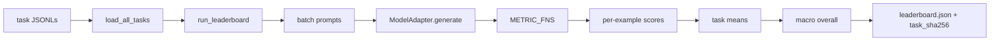

# Language Model Evaluation Harness

A model that does well on a task you cannot define is a model that does well by accident. This
module is the task definition, the metric, the runner, and the leaderboard in one short, swappable
shape. Five JSONL fixture tasks, five metrics written from scratch, one adapter seam, and a
schema-versioned leaderboard.

Everything runs offline on CPU with the Python standard library. The default adapter is a
deterministic fixture matcher; a real model plugs in through the same `ModelAdapter` interface.

## Architecture



The harness owns the task contract, normalization, scoring, batching, aggregation, and output
format. The adapter owns everything model-specific. Swapping the adapter moves the leaderboard;
swapping the tasks moves the leaderboard; nothing else does.

## Task specification

A task is a `.jsonl` file under `outputs/tasks/`; the file stem is the task name. Blank lines and
lines beginning with `#` (including indented comments) are skipped, so contributors can annotate
the fixtures. Every other line is one JSON object:

```json
{"id": "arith-00", "prompt": "compute: 2 + 2", "targets": ["4"], "metric": "exact_match"}
```

Executable tasks carry a side payload in `extras`:

```json
{
  "id": "code-00",
  "prompt": "python: write a function f that doubles its input",
  "targets": ["ok"],
  "metric": "code_exec",
  "extras": {"io_pairs": [[1, 2], [3, 6], [0, 0]]}
}
```

The loader validates the shape before any scoring: non-empty `id`, `prompt`, and `targets`;
non-empty string targets; a known metric; unique IDs per file; one metric per file; and a
non-empty two-element `io_pairs` list for `code_exec`. Errors report `file:line`. The first run
of `main.py` seeds the five fixture tasks if the task directory has no `.jsonl` files. Seeding
never overwrites an existing task file.

## Metrics

Each metric is a function from `(prediction, targets, extras)` to a float in `[0, 1]`:

| Metric | Used by | Rule |
| --- | --- | --- |
| `exact_match` | arithmetic | Lowercase, collapse whitespace, compare with any target |
| `rouge_l` | summary | Token-level longest-common-subsequence F1, max over targets |
| `code_exec` | code-exec | Execute the prediction, call `f(input)`, compare each output |
| `multiple_choice` | multiple-choice | Uppercase the first character of the prediction and match targets |
| `substring_contains` | generation | Normalize, then require any non-empty target substring |

ROUGE-L uses `precision = LCS / len(prediction_tokens)`, `recall = LCS / len(reference_tokens)`,
and `F1 = 2PR / (P + R)` with β = 1. Both empty is 1.0; one empty is 0.0. Multiple targets take
the maximum score. `multiple_choice` deliberately reads only the first character, so `b) Mars`
matches target `B`.

`code_exec` compiles the prediction after rejecting imports, dunder names, and dunder attribute
access. It executes in a fresh namespace whose `__builtins__` is an allowlist (no `__import__`,
`open`, `eval`, `exec`, `getattr`, or `type`). It requires a callable `f`, catches exceptions per
input-output pair, and compares return values strictly (notably `True` does not equal `1`). A
top-level infinite loop is not interrupted; see limitations.

## Adapter seam

```python
class ModelAdapter(Protocol):
    @property
    def name(self) -> str: ...

    def generate(self, prompts: Sequence[str]) -> list[str]: ...
```

`ToyAdapter` is a deterministic pattern matcher that returns the expected answer for every
fixture prompt. It is a fixture control, not evidence of model quality. It parses arithmetic,
returns the fixture summary/code/letter/string answers, and returns `""` for unknown prompts.

`HttpAdapter` is the optional real-provider seam. It POSTs one JSON object per prompt:

```text
POST <endpoint>
Authorization: Bearer <api_key>   # only when a key is supplied
Content-Type: application/json

{"model": "<model>", "prompt": "<prompt>"}
```

and expects `{"text": "<completion>"}`. The default transport uses
`urllib.request.urlopen`; tests inject a fake transport, so the test suite never touches the
network. There are no retries and no vendor SDK.

## Quickstart

Requires Python 3.11+ and [uv](https://docs.astral.sh/uv/). The runtime itself has no third-party
dependencies.

```bash
cd 49-lm-eval-harness
./verify.sh
python3 code/main.py --include-per-example
```

`verify.sh` installs the pinned dev dependencies into `.venv/`, runs the test suite and strict
mypy, then seeds a fresh task directory and asserts the end-to-end result. `main.py` writes:

```text
outputs/tasks/*.jsonl                 # five seeded fixture tasks
outputs/leaderboard.json              # schema, task scores, counts, latency, hashes
outputs/skill-lm-eval-harness.md      # reusable one-page recipe
```

Inspect the leaderboard, or re-run with `--batch-size 3`. The default `--output` is
`outputs/leaderboard.json`; the skill recipe is written next to the leaderboard. Relative CLI paths
resolve from the current directory; the defaults resolve from the module root.

## What runs offline

After dependency installation, everything in the quickstart and test suite runs offline:

- no dataset download, checkpoint, API key, GPU, or network call;
- tests use `tmp_path` for task and output files;
- the HTTP adapter's transport is replaced with an in-process fake in tests;
- the measured leaderboard uses the toy adapter.

## Optional real-provider or GPU mode

No real provider was called for this project, so no provider score is claimed. To point the
harness at a served model, use `HttpAdapter` and the same tasks and metrics:

```bash
PYTHONPATH=code uv run python - <<'PY'
import os
from pathlib import Path

from main import HttpAdapter, load_all_tasks, run_leaderboard, write_leaderboard

tasks = load_all_tasks(Path("outputs/tasks"))
adapter = HttpAdapter(
    "https://your-endpoint.example/generate",
    api_key=os.environ["LM_EVAL_API_KEY"],
    model="vendor-v1",
    timeout=30.0,
)
board = run_leaderboard(tasks, adapter, batch_size=4)
write_leaderboard(board, Path("outputs/leaderboard-http.json"), include_per_example=True)
PY
```

A vendor whose wire format differs needs a small endpoint shim that accepts
`{"model", "prompt"}` and returns `{"text"}`. Keep the key in the environment, not in source. A
GPU-hosted model works through the same HTTP path; the harness itself is CPU-only and model-
agnostic.

## Reproducibility

- `schema` is the literal `lm-eval-harness/v1`, so dashboards can reject unknown formats.
- Task names are iterated in sorted order; a task score is the mean per-example score, and the
  overall score is the macro average of task scores, not an example-weighted average. `correct`
  counts examples that scored exactly 1.0; partial metric credit is preserved in the task mean.
- Every task record carries `task_sha256`: SHA-256 over canonical parsed content (IDs, prompts,
  targets, metric, extras). Comments and blank lines do not change it; changing a target does.
- `--include-per-example` records `id`, `prompt`, `targets`, `prediction`, and `score` for diffing
  predictions when a score moves.
- `latency_ms` is measured per task and is machine-dependent; scores and hashes are not.
- `--batch-size` caps prompts per adapter call (default 8). No timestamps or random seeds are
  involved in scoring.

## Measured results

Measured locally with the default fixtures and `ToyAdapter` (the test suite also measures the
silent-adapter control):

| Task | Examples | Metric | Score |
| --- | ---: | --- | ---: |
| arithmetic | 4 | exact_match | 1.000 |
| summary | 3 | rouge_l | 1.000 |
| code-exec | 3 | code_exec | 1.000 |
| multiple-choice | 3 | multiple_choice | 1.000 |
| generation | 3 | substring_contains | 1.000 |
| **overall** | **16** | macro average | **1.000** |

The same harness with an adapter that returns `""` for every prompt measures 0.000 overall in
`test_silent_adapter_scores_zero`. On the development machine, per-task latency for the toy run
was below 0.3 ms; the exact values are in `leaderboard.json` and vary by machine.

## Limitations

- The fixtures are tiny and the toy adapter is hand-mapped. A 1.000 here proves the harness
  plumbing and metric behavior, not language-model quality.
- ROUGE-L is lexical: synonyms, stemming, and reordering beyond subsequence order are not rewarded.
- `multiple_choice` reads only the first character. It does not validate that the letter is one of
  the printed options beyond the target set.
- `code_exec` is a restricted namespace, not a security sandbox. It blocks imports, dunder access,
  and unsafe builtins, but it has no timeout, resource limit, or OS isolation. Run untrusted
  model-generated code in a separate process/container with a timeout.
- There are no confidence intervals or repeated samples; one deterministic run is reported.
- Latency is noisy and should not be compared across machines without a warm-up and repetitions.

Spec exercises 1–4 (a sixth custom metric, stdout capture, a leaderboard diff command, and a
per-example timeout) are intentionally omitted. Exercise 5 (SHA-256 task pinning) is implemented,
and per-example prediction records cover the prediction-diffing requirement.

## References

1. **AI Engineering from Scratch — Language Model Evaluation Harness capstone.** The task JSONL
   contract, five metrics, adapter seam, and leaderboard requirements.
   <https://aiengineeringfromscratch.com/learn/capstone-projects/lm-eval-harness>
2. **EleutherAI lm-evaluation-harness — Scoring & Metrics.** The separation between per-sample
   scoring, reduction, and aggregation informed `run_task` and the macro leaderboard.
   <https://lm-evaluation-harness.readthedocs.io/writing_tasks/scoring_and_metrics>
3. **Hugging Face Lighteval — Adding a New Metric.** The sample-level versus corpus-level metric
   split informed the `(prediction, targets, extras) -> float` contract and task averaging.
   <https://huggingface.co/docs/lighteval/en/adding-a-new-metric>
4. **RestrictedPython — Security Considerations.** The guidance that language guards do not
   restrict the environment informed the builtins allowlist, import rejection, and the explicit
   "not a sandbox" limitation.
   <https://restrictedpython.readthedocs.io/en/latest/usage/security_considerations.html>
5. **ROUGE-L: Longest Common Subsequence.** The precision, recall, and F1 definitions used by
   `rouge_l`.
   <https://mbrenndoerfer.com/writing/rouge-scores-text-summarization-evaluation-metrics/rouge-l-longest-common-subsequence>

## License

MIT © 2026 Pedro Monteiro. See `LICENSE`.
